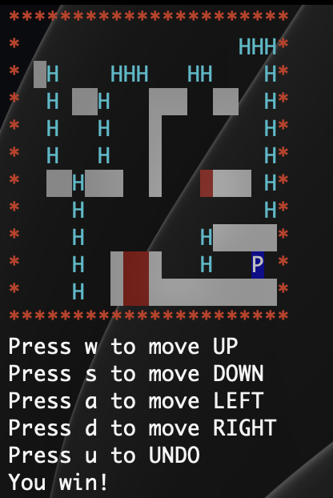
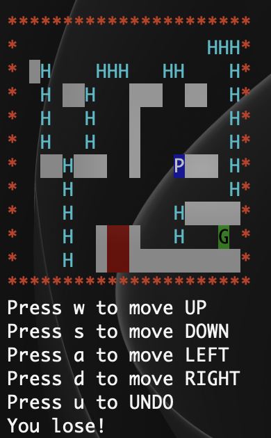
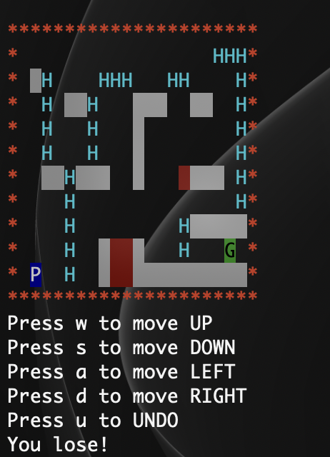

# 🏰 Dungeon ASCII Game

A terminal-based ASCII platform game written in **C89** for Curtin University's
Unix & C Programming (COMP1000).

Guide the player (`P`) to the goal (`G`) using blocks and ladders, while
avoiding danger zones and falls of 5 or more rows. 🎮

## ✨ Features

- 🗺️ Map loaded from a text file into a dynamically allocated 2D array
- 🎨 Coloured ASCII display (red border, white blocks, red danger zones, blue player, green goal)
- ⌨️ Single-key input without pressing Enter
- 🪜 Horizontal movement, ladder climbing and a falling animation
- 🏆 Win and lose conditions (goal, danger zone, fall of 5 or more rows)
- ↩️ Unlimited undo using a generic linked list

## 🛠️ Build and run

Requires `gcc` and `make` on Linux.

```
make
./dungeon map.txt
```

🧹 Remove build files with:

```
make clean
```

## 🕹️ Controls

| Key | Action |
|-----|--------|
| ⬆️ `w` | Move up (on a ladder) |
| ⬇️ `s` | Move down |
| ⬅️ `a` | Move left |
| ➡️ `d` | Move right |
| ↩️ `u` | Undo the last move |

Other keys are ignored.

## 📖 Game instructions

**Goal:** move the player 🟦 `P` to the goal 🟩 `G`. Walk along blocks, climb
ladders (`H`) and use `u` to undo mistakes.

### 🏆 One way to win

| Result | How |
|--------|-----|
| ✅ **Win** | Reach the goal `G`. This counts even if you land on it after a fall of 5 or more rows. |

### 💀 Two ways to lose

| Result | How |
|--------|-----|
| ❌ **Lose 1: Danger zone** | Touch any red danger zone 🟥, including while falling through it. |
| ❌ **Lose 2: Fall too far** | Fall **5 or more rows** and land on anything other than the goal. A fall of 4 rows or fewer is safe. |

### 📝 Rules to remember

- 🧱 You cannot walk through blocks or the map border.
- 🪜 You can only move up or down while holding a ladder, or when standing on top of one.
- ⬇️ If you are not standing on a block, ladder or the bottom of the map, you fall automatically. Keys cannot change a fall.
- ↩️ Undo moves you back to where you stood before your last move. After a fall, it returns you to the spot **before** the fall. You cannot undo once the game is over.

## 📸 Screenshots

### 🏆 Win: reaching the goal


### 💀 Lose 1: touching a danger zone


### 💀 Lose 2: falling 5 or more rows


## 📄 Map file format

The first line holds the number of rows and columns. The remaining lines hold
the grid values:

| Value | Meaning | On screen |
|-------|---------|-----------|
| 0 | Empty space | ` ` |
| 1 | Block | ⬜ white background |
| 2 | Ladder | `H` |
| 3 | Danger zone | 🟥 red background |
| 4 | Player start | 🟦 `P` |
| 5 | Goal | 🟩 `G` |

Example (10 rows, 20 columns): the first line is `10 20`, followed by 10 lines of 20 numbers.

## 📁 Project structure

| File | Purpose |
|------|---------|
| `main.c` | 🚪 Argument checking and program flow |
| `map.c / map.h` | 🗺️ Map loading, storage and cleanup |
| `game.c / game.h` | 🎮 Movement, falling, win/lose and undo logic |
| `display.c / display.h` | 🖥️ Screen clearing and map printing |
| `linkedList.c / linkedList.h` | 🔗 Generic linked list used for undo |
| `color.c / color.h` | 🎨 Provided colour helper |
| `terminal.c / terminal.h` | ⌨️ Raw keyboard input |
| `newSleep.c / newSleep.h` | ⏱️ Provided sleep helper for animation |
| `makefile` | 🔨 Build rules |
| `screenshots/` | 📸 Images used in this README |

## 🔍 Memory check

```
valgrind --leak-check=full ./dungeon map.txt
```

## 📥 Clone and run

1. 📋 **Clone** the repository:
   ```
   git clone https://github.com/RayanMendis56/dungeon-ascii-game.git
   ```
2. 📂 **Open** the project folder:
   ```
   cd dungeon-ascii-game
   ```
3. 🔨 **Build** the game:
   ```
   make
   ```
4. ▶️ **Run** it with a map file:
   ```
   ./dungeon map.txt
   ```

## 👤 Author

Rayan Mendis, IT Undergraduate at Curtin University.
